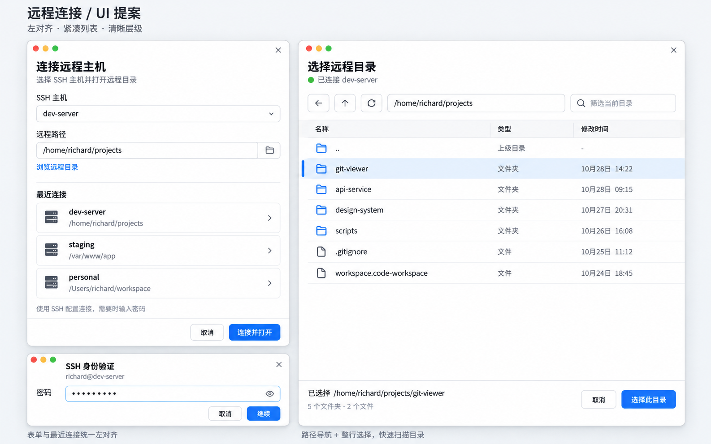

# 远程连接与目录选择 UI 实施方案

日期：2026-10-28
状态：设计方向已确认；仅保存方案，暂不实施代码。

## 用户确认

- 按已展示的示意图优化远程登录面板与远程文件列表。
- 标题、表单、最近连接、目录及文件名统一左对齐，不使用水平居中的列表按钮。
- SSH 入口与连接状态放在窗口左下角，位置和交互参考 VS Code。
- 用户最新指示：先保存实施文档，后续再开发。

## 设计参考

图片用于确认视觉方向，不是已实现截图。示例主机、路径、日期与计数均为示意数据。实现沿用当前应用语言、亮暗主题与原生组件体系。

## 远程连接面板

- 简洁原生工具风格：清晰标题、次级说明、细边框、适量留白和单一主操作。
- SSH 主机输入与候选列表靠左，保留刷新主机配置入口。
- 最近连接使用整行可点击区域：第一行主机名，第二行弱化路径，内容靠左；长路径省略并提供完整提示。
- 底部操作区独立，取消与主操作靠右。
- 保留当前“先连接主机，再浏览目录”的流程；示意图中的预连接路径输入不构成新增流程要求。
- 密码/验证码采用紧凑独立面板，标题、主机、说明和输入左对齐，保留掩码、提交与取消逻辑。凭据不持久化、不写日志。

## 远程目录选择面板

- 顶部显示标题、当前主机和真实连接状态，保留切换主机入口。
- 导航区包含上级目录、可输入的路径、跳转与刷新；路径输入支持回车跳转。
- 内容区为紧凑列表，名称列靠左，目录/工作区图标保持统一宽度与基线，整行提供悬停和选中态。
- 单击选择，目录双击或回车进入；底部明确显示待打开路径。打开动作只作用于当前已选目标，避免显示与实际目标不一致。
- 首版沿用当前目录及 `.code-workspace` 文件过滤，不增加普通文件打开能力。名称、类型可直接展示；修改时间等列仅在数据源具备可靠字段时加入，不伪造元数据。
- 若加入筛选，限定当前已加载目录；不承诺递归远程搜索。
- 加载、空目录、错误与重试状态清楚区分；请求代际保护、取消和已认证会话复用保持有效。

## 窗口左下角 SSH 入口

- 在窗口底部最左侧提供紧凑远程状态区域，跨 Editor、Git Log、Commit 模式保持同一位置。
- 本地状态显示远程连接图标及连接入口；连接中显示目标主机和忙碌状态；已连接显示 `SSH: <host>`；离线/失败显示准确状态。
- 状态来自实际连接/会话，不以曾输入的 `SSHHost` 值直接判定在线。
- 点击入口打开远程操作菜单：连接主机、打开/切换远程目录、切换主机；断开操作按已有会话关闭能力落实，并复用未保存文件保护。
- 仅恢复承载 SSH 所需的紧凑底部区域，不恢复此前移除的冗余统计信息；避免在标题栏重复放置同等主入口。
- 状态不能只依赖颜色，提供文本、提示及键盘可访问名称。

## 预计修改范围

- `internal/ui/local/remote_browser.go`：面板结构、目录行、导航、选中与加载反馈。
- `internal/ui/local/remote_dialog.go`：连接表单及最近连接交互。
- 当前密码提示实现：左对齐与紧凑布局，实施时先定位最新代码。
- `internal/ui/local/shell.go` 及相关菜单/工具栏：左下角 SSH 区域与操作入口。
- 相关 UI/会话测试与实施记录；不修改 SSH 配置、凭据策略或远端命令契约。

## 实施顺序与验收

1. 阅读最新分支、组件 API 与现有测试，保护已有无关改动。
2. 实现连接面板和目录列表，核对左对齐、长路径、空列表及窄窗口布局。
3. 实现左下角入口，核对本地、连接中、已连接、失败/离线和模式切换状态。
4. 验证路径跳转、选择/进入目录、工作区选择、取消、切换主机和未保存保护；补充有实际回归价值的测试。
5. 执行对应 Go 测试、vet、原生构建与窗口截图检查；亮暗主题均检查。真实 SSH 验证须明确记录是否实际执行。
6. 更新任务表和执行记录，仅提交本次相关代码与文档到本地 Git，不推送。

## 本次保存记录

已保存本实施文档与原始设计示意图，并将任务登记为待实施。本次未修改产品代码，未执行产品测试、构建或真实 SSH 验证。
